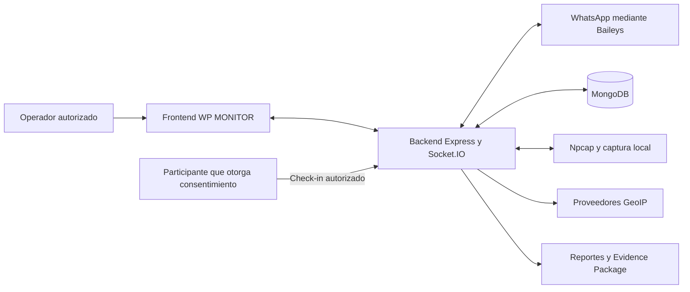
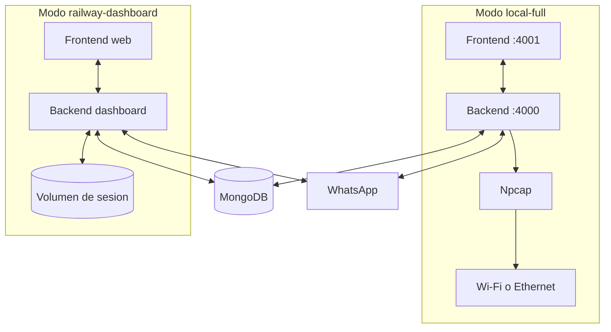

# Plan Maestro de Documentacion de WP MONITOR

> Estado historico: la estructura principal fue implementada el 4 de agosto de 2026. Consulta `docs/README.md` como indice canonico; este archivo permanece como registro del plan original.

## Objetivo

Construir una documentacion extensa, verificable y mantenible que permita a una persona nueva comprender, instalar, ejecutar, operar, auditar y contribuir a WP MONITOR sin depender del autor original.

Este plan cubre el modo `local-full`, el modo `railway-dashboard`, Docker, el frontend, el backend, MongoDB, Baileys, captura local, check-ins autorizados, reportes y cadena de custodia.

## Alcance normativo

La documentacion tomara como referencia las siguientes normas, sin afirmar certificacion ni conformidad formal:

| Referencia | Aplicacion documental |
| --- | --- |
| [ISO/IEC/IEEE 42010:2022](https://www.iso.org/standard/74393.html) | Vistas, puntos de vista, interesados, decisiones y descripcion de arquitectura. |
| [ISO/IEC 25010:2023](https://www.iso.org/standard/78176.html) | Calidad funcional, rendimiento, compatibilidad, usabilidad, fiabilidad, seguridad, mantenibilidad y portabilidad. |
| [ISO/IEC 27001:2022](https://www.iso.org/standard/27001) | Contexto de seguridad, activos, riesgos, controles, responsabilidades y mejora continua. |
| [ISO/IEC 27037:2012](https://www.iso.org/standard/44381.html) | Identificacion, recoleccion, adquisicion, preservacion y trazabilidad de evidencia digital potencial. |

Regla obligatoria: usar expresiones como `alineado con`, `inspirado en` o `tomado como referencia`. No usar `certificado`, `cumple ISO` o `conforme a ISO` sin una evaluacion formal independiente.

## Audiencias

- Operador que instala y utiliza WP MONITOR localmente.
- Administrador que despliega dashboard y persistencia.
- Investigador autorizado que interpreta resultados.
- Auditor que revisa trazabilidad, hashes y limitaciones.
- Desarrollador que modifica frontend, backend o reportes.
- Responsable de seguridad que administra secretos, accesos y retencion.
- Responsable institucional que evalua riesgos y uso permitido.

## Estructura documental objetivo

```text
docs/
|-- README.md
|-- getting-started.md
|-- architecture.md
|-- deployment.md
|-- configuration.md
|-- user-guide.md
|-- operations.md
|-- troubleshooting.md
|-- data-model.md
|-- api-reference.md
|-- security-model.md
|-- evidence-and-chain-of-custody.md
|-- quality-and-testing.md
|-- limitations-and-responsible-use.md
|-- contributing-development.md
|-- glossary.md
|-- adr/
|   |-- README.md
|   |-- 0001-deployment-split.md
|   |-- 0002-local-packet-capture.md
|   `-- 0003-evidence-package-integrity.md
`-- diagrams/
    `-- README.md
```

Los documentos actuales se reutilizaran cuando sean correctos. No se duplicara informacion entre archivos; cada tema tendra un documento canonico y el resto lo enlazara.

## Contenido obligatorio

### 1. Inicio rapido

- Requisitos de sistema operativo, Node.js y gestor de paquetes oficial.
- MongoDB local o Atlas.
- Npcap y permisos de administrador en Windows para captura local.
- Variables minimas mediante `.env.example`.
- Instalacion limpia desde un clon nuevo.
- Arranque con un solo comando en puertos 4000 y 4001.
- Conexion inicial de WhatsApp mediante QR.
- Creacion del primer caso autorizado.
- Prueba de salud, frontend y WebSocket.
- Procedimiento limpio de detencion y reinicio.

### 2. Arquitectura

- Objetivo y alcance del sistema.
- Interesados y preocupaciones arquitectonicas.
- Limites de confianza y activos protegidos.
- Vista de contexto.
- Vista de contenedores y procesos.
- Vista de componentes frontend/backend.
- Vista de datos y persistencia.
- Vista de despliegue local, Docker y Railway.
- Flujos sincronos, WebSocket y eventos Baileys.
- Dependencias externas y comportamiento degradado.
- Decisiones arquitectonicas y alternativas descartadas.

### 3. Guia de uso

- Cases: crear, activar, relacionar evidencia y cerrar.
- WhatsApp Tracker: conectar QR, agregar contacto, interpretar RTT y estados.
- Network Monitor: prerrequisitos, interfaz, filtros, captura y exportaciones.
- Call Analysis: captura manual/automatica, relays, infraestructura, scoring y limites.
- Authorized Check-In: consentimiento, preview, GPS opcional, IP observada y revocacion.
- Audit Trail: filtros, paginacion, eventos y exportaciones.
- Reportes JSON, HTML, PDF y ZIP.
- Procedimientos operativos con resultados esperados y errores frecuentes.

### 4. Seguridad y privacidad

- Modelo de autenticacion actual y limitaciones.
- Administracion de `DASHBOARD_TOKEN` y secretos.
- CORS, proxy confiable y exposicion de endpoints.
- Proteccion de la sesion Baileys.
- Datos personales y minimizacion.
- Retencion y TTL de MongoDB.
- Riesgos de logs, uploads, reportes y capturas.
- Matriz de amenazas y controles.
- Procedimiento de reporte de vulnerabilidades.
- Uso autorizado, consentimiento y lenguaje no concluyente.

### 5. Evidencia y cadena de custodia

- Fuentes de datos observadas.
- Identificacion de caso, operador y autorizacion.
- Marcas de tiempo y zona horaria.
- Hashes por seccion y hash del paquete.
- Manifest, anexos y exportaciones.
- Preservacion, transferencia, verificacion y archivo.
- Diferencia entre observacion, inferencia y conclusion.
- Limitaciones de RTT, presencia, GeoIP y candidatos de red.
- Procedimiento de verificacion independiente.

### 6. Calidad, pruebas y operacion

- Matriz de calidad basada en ISO/IEC 25010:2023.
- Pruebas unitarias, integracion, contratos HTTP y reportes.
- Smoke tests local y Railway.
- QA visual desktop/movil.
- Criterios de aceptacion por modulo.
- Health checks, logs y estados degradados.
- Backup, recuperacion y rotacion de credenciales.
- Compatibilidad soportada y politica de versiones.

## Diagramas Mermaid obligatorios

Cada diagrama debe indicar alcance, fecha de revision y documento canonico.

1. Contexto general del sistema.
2. Contenedores y responsabilidades.
3. Despliegue `local-full` frente a `railway-dashboard`.
4. Secuencia de arranque backend/frontend.
5. Secuencia de conexion QR y restauracion Baileys.
6. Flujo RTT/presencia/eventos hasta el dashboard.
7. Flujo de captura de red local.
8. Flujo de analisis de llamada y clasificacion de IP.
9. Flujo de check-in autorizado y consentimiento.
10. Flujo de creacion del Evidence Package y reportes.
11. Modelo de datos MongoDB y relaciones por caso.
12. Estados de Case, Check-In, captura y llamada.
13. Limites de confianza y flujo de secretos.
14. Recuperacion ante MongoDB, WhatsApp o captura no disponible.

## Vista preliminar de contexto



## Vista preliminar de despliegue



## Reglas editoriales

- Comandos comprobados y copiables.
- Rutas y nombres iguales al codigo vigente.
- Variables sin secretos ni valores reales.
- Capturas con datos sinteticos.
- Fechas ISO 8601 y zona horaria indicada.
- Diferenciar claramente requisitos, opciones y limitaciones.
- No prometer identidad, ubicacion exacta ni capacidades no observables.
- Mantener una unica fuente de verdad por tema.
- Actualizar documentacion dentro del mismo cambio que modifica comportamiento.
- Marcar version del producto revisada en cada guia operativa.

## Fases de ejecucion

### Fase A - Saneamiento

- [ ] Retirar documentos internos que no viajaran al repositorio publico.
- [ ] Inventariar y validar la documentacion existente.
- [x] Resolver gestor de paquetes, Docker, Signal y entrada principal.
- [ ] Definir nombre y URL definitivos del repositorio.

### Fase B - Arquitectura y despliegue

- [ ] Escribir `architecture.md` conforme al enfoque de ISO/IEC/IEEE 42010:2022.
- [ ] Crear los diagramas de contexto, contenedores, componentes y despliegue.
- [ ] Documentar instalacion local, Docker y Railway desde cero.
- [ ] Documentar configuracion y matriz de variables.

### Fase C - Operacion y seguridad

- [ ] Escribir la guia funcional completa por pantalla.
- [ ] Documentar seguridad, privacidad, amenazas y secretos.
- [ ] Documentar evidencia y cadena de custodia.
- [ ] Crear troubleshooting y recuperacion.

### Fase D - Calidad y validacion

- [ ] Crear matriz ISO/IEC 25010:2023 con pruebas y evidencia de verificacion.
- [ ] Ejecutar todos los comandos desde un clon limpio.
- [ ] Validar todos los Mermaid en GitHub.
- [ ] Revisar enlaces, idioma, ortografia y consistencia.
- [ ] Aprobar revision tecnica, operativa, seguridad y legal.

## Definicion de terminado

- Una persona nueva instala y levanta el producto siguiendo solamente la documentacion.
- Los modos local y Railway estan claramente separados.
- Todas las variables y dependencias tienen proposito y ejemplo seguro.
- La arquitectura completa puede entenderse mediante texto y Mermaid.
- Cada modulo tiene guia, limites, errores y criterio de exito.
- La cadena de custodia explica origen, integridad y preservacion sin exagerar valor probatorio.
- Los controles de seguridad se relacionan con riesgos concretos.
- La matriz de calidad enlaza requisitos, pruebas y resultados.
- No existen secretos, datos reales, enlaces rotos ni instrucciones obsoletas.
- Ningun texto afirma certificacion ISO inexistente.
